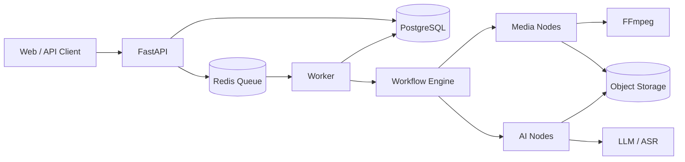

# AutoCut 架构设计 v0.1

## 1. 总览



第一阶段用单体 API 加独立 Worker，共享 PostgreSQL 和 Redis。视频处理是 CPU 密集型，必须和 API 进程分开，否则一个转码任务就能把接口拖死。

## 2. 模块划分

| 模块 | 职责 | 第一版形态 |
| --- | --- | --- |
| API | 鉴权、任务、资产、模板、下载 | FastAPI |
| Worker | 消费任务、执行工作流 | Python 进程 |
| Engine | 节点注册、DAG 调度、重试、检查点 | 纯 Python |
| Nodes | 媒体与 AI 能力封装 | 可插拔类 |
| Storage | 素材与产物 | 本地目录，后续 S3/OSS |
| DB | 租户、任务、节点、用量 | PostgreSQL |
| Queue | 任务分发 | Redis |

## 3. 工作流引擎

### 3.1 核心对象

```text
WorkflowSpec   一次工作流定义，包含若干 NodeSpec
NodeSpec       节点实例：id、type、params、needs
Node           可执行能力：run(ctx, inputs) -> dict
NodeRegistry   type 到 Node 类的映射
RunContext     一次运行的上下文：job_id、工作目录、参数、输出、事件
Executor       按 DAG 分层执行，处理重试、并发、检查点
```

### 3.2 节点契约

- 输入：`params`（YAML 中的静态参数）和 `upstream`（依赖节点的输出）
- 输出：可 JSON 序列化的字典
- 节点不直接访问数据库，也不关心队列
- 节点通过 `RunContext` 获取工作目录和任务参数

### 3.3 调度

- 用 Kahn 算法把 DAG 分层，同一层节点并发执行
- 并发上限由 `max_concurrency` 控制，默认 2
- 一个节点失败并重试耗尽后，后续节点标记为 skipped
- 每层执行完写一次检查点

### 3.4 重试与续跑

- 每个节点声明 `RetryPolicy`：最大次数、初始退避、最大退避
- 重试只重跑当前节点，不重跑已成功的上游
- 检查点文件：`work/{job_id}/checkpoint.json`
- 重启后加载检查点，跳过已成功节点
- 节点必须幂等：相同输入重复执行结果一致，产物覆盖写

### 3.5 状态机

任务：

```text
queued -> running -> succeeded
                  -> failed
                  -> canceled
                  -> awaiting_review -> running -> succeeded
```

节点：

```text
pending -> running -> succeeded
                   -> failed
                   -> skipped
```

## 4. 数据模型

```text
tenants(id, name, plan, created_at)
users(id, tenant_id, email, password_hash, role, created_at)
assets(id, tenant_id, kind, storage_key, sha256, size_bytes,
       duration_ms, width, height, status, created_at)
workflows(id, tenant_id, name, version, spec_json, is_template, created_at)
jobs(id, tenant_id, workflow_id, status, params_json, idempotency_key,
     created_by, created_at, started_at, finished_at, error)
job_nodes(id, job_id, node_id, type, status, attempt, started_at,
          finished_at, duration_ms, cost_usd, error, outputs_json)
artifacts(id, job_id, node_id, kind, storage_key, size_bytes, meta_json)
usage_records(id, tenant_id, job_id, provider, model, input_tokens,
              output_tokens, cost_usd, created_at)
reviews(id, job_id, artifact_id, reviewer_id, status, comment, created_at)
```

关键约束：

- `jobs.idempotency_key` 在租户内唯一，防止重复提交
- `job_nodes(job_id, node_id)` 唯一
- 所有查询必须带 `tenant_id`，由仓储层强制

## 5. 存储布局

```text
s3://autocut/{tenant_id}/assets/{sha256[:2]}/{sha256}.{ext}
s3://autocut/{tenant_id}/jobs/{job_id}/nodes/{node_id}/{filename}
s3://autocut/{tenant_id}/exports/{job_id}/{artifact_id}.mp4
```

规则：

- 素材按内容哈希去重，同一租户重复上传只存一份
- 产物按任务和节点分目录，方便清理和重跑
- 下载走预签名 URL，有效期 15 分钟
- 删除任务时先删产物，再删元数据

## 6. 任务队列

- 第一版：Redis + 单 Worker，任务串行拉取，工作流内部并发
- 第二阶段：按租户配额和任务优先级分队列
- 第三阶段：渲染任务单独队列，按机器打标签调度

任务消息只存 `job_id`，真实状态以数据库为准，避免消息重复导致状态错乱。

## 7. 可观测性

每个节点记录：

- `node_id`、`type`、`attempt`
- 开始时间、结束时间、耗时
- 是否命中检查点
- 失败原因和堆栈摘要
- 模型、token 数、成本
- 产物路径和大小

对外提供：

- 任务详情接口返回节点级事件
- 结构化日志，按 `job_id` 串联
- 指标：任务数、成功率、P95 时延、单条成本

## 8. 安全

- FFmpeg 使用参数数组调用，不拼 shell
- 上传校验扩展名、MIME、大小、时长
- 素材和产物默认私有，不暴露公开桶
- 租户隔离在仓储层和对象存储前缀双重保证
- API Key 只存服务端，日志脱敏
- 模型输出做结构校验，解析失败按失败处理，不猜测

## 9. 技术选型理由

| 选择 | 理由 |
| --- | --- |
| FastAPI | 异步、类型友好、接口文档自动生成 |
| 自研工作流引擎 | 节点少、逻辑清晰，比直接上 Airflow 更轻，也更能讲清楚 |
| FFmpeg | 视频处理的通用底座，稳定、可脚本化 |
| PostgreSQL | 任务、用量、租户关系都需要事务 |
| Redis | 队列和进度事件，部署成本低 |
| 对象存储 | 视频文件不适合放数据库或本地盘 |
| Next.js | 三页应用足够，后续扩展也方便 |

## 10. 演进路径

```text
单机 CLI
  -> FastAPI + 单 Worker
  -> PostgreSQL 持久化 + Redis 队列
  -> 对象存储 + 多 Worker
  -> 按队列拆分渲染与 AI
  -> 多机调度
```

每一步都保留上一层的接口，避免推倒重来。
