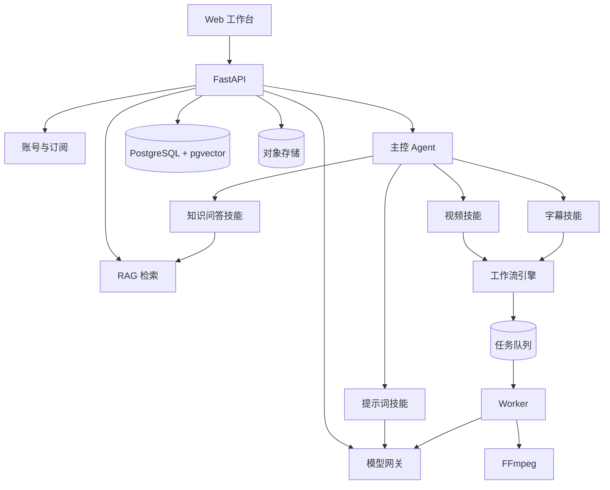

# AutoCut 平台总体架构

## 1. 产品定义

AutoCut 是一个面向内容团队的 AI 视频生产平台：

```text
用户说需求
  -> 主控 Agent 识别意图、补齐参数、选择技能
  -> 技能模块执行（提示词 / 视频 / 字幕 / 知识问答）
  -> 工作流引擎产出结果
  -> 用户审核、下载、计费
```

卖点不是「又一个聊天框」，而是「说一句话，系统自己选流程并产出成片」。

## 2. 系统架构



## 3. 主控 Agent

不要做「多个自由对话的 Agent 互相聊天」，成本高、结果不稳定。做成三段式：

### 3.1 意图识别

输入用户原话，输出结构化 JSON：

```json
{
  "intent": "video.generate",
  "confidence": 0.86,
  "slots": {
    "source": "uploaded_asset_id",
    "platform": "douyin",
    "duration": 60,
    "style": "口播带货"
  },
  "missing": ["max_clips"]
}
```

意图集合第一版控制在 5 个：

| intent | 说明 |
| --- | --- |
| `prompt.generate` | 生成视频提示词、脚本、分镜 |
| `video.generate` | 从素材自动剪出成片 |
| `subtitle.generate` | 生成字幕 |
| `knowledge.answer` | 基于知识库回答 |
| `chat` | 普通对话 |

### 3.2 计划生成

把意图翻译成可执行计划：

```json
{
  "skill": "video.generate",
  "workflow": "clip",
  "inputs": {"source": "...", "max_clips": 5, "aspects": ["9:16"]}
}
```

### 3.3 执行与校验

- 调用技能
- 校验产物（时长、规格、字幕、文件存在）
- 失败时最多重试一次，仍失败则把原因翻译成人话返回

## 4. 技能模块

每个技能是一个带类型签名的模块，不是自由 Agent：

```python
class Skill(Protocol):
    name: str
    inputs: dict[str, PortSpec]
    outputs: dict[str, PortSpec]

    async def run(self, ctx: SkillContext, inputs: dict) -> dict:
        ...
```

第一版技能：

| 技能 | 输入 | 输出 |
| --- | --- | --- |
| `prompt.generate` | 产品信息、平台、风格、知识库 | 提示词、脚本、分镜 |
| `video.generate` | 素材、时长、平台、模板 | 成片列表 |
| `subtitle.generate` | 视频 | SRT |
| `knowledge.answer` | 问题、知识库 | 答案 + 引用 |

技能可以内部调用工作流，也可以只调用模型。对外统一成同一套输入输出协议。

## 5. RAG 检索

### 5.1 范围

只做「内容生产知识」检索，不做通用企业知识库：

- 品牌规范、产品卖点、历史爆款脚本
- 平台规则、话术模板、禁用词
- 客户提供的案例和素材说明

### 5.2 链路

```text
上传 -> 解析 -> 结构化切分 -> Embedding -> pgvector
问题 -> 改写 -> 向量检索 + 关键词检索 -> Rerank -> 上下文拼装 -> 引用
```

技术选型：

| 环节 | 第一版 | 后续 |
| --- | --- | --- |
| 解析 | TXT / MD / PDF / DOCX | 视频字幕、表格 |
| 切分 | 按标题 + 句子 | 语义切分 |
| Embedding | BGE-M3 或通义 Embedding | 多模型对比 |
| 向量库 | PostgreSQL + pgvector | 专用向量库 |
| 检索 | 向量 + 关键词 | 混合检索 + Rerank |
| 评测 | 30 条问答，Recall@5 |  faithfulness、引用准确率 |

### 5.3 防幻觉

- 回答必须带引用
- 检索分数低于阈值时明确说「知识库没有」
- Prompt 里禁止编造价格、政策、资质

## 6. 模型网关

国内主流模型基本都兼容 OpenAI 协议，用一套适配器加配置表：

| 厂商 | Base URL | 备注 |
| --- | --- | --- |
| DeepSeek | `https://api.deepseek.com` | 便宜，适合意图和选段 |
| 通义千问 | `https://dashscope.aliyuncs.com/compatible-mode/v1` | 多模态能力全 |
| 豆包 | `https://ark.cn-beijing.volces.com/api/v3` | 火山引擎 |
| 智谱 | `https://open.bigmodel.cn/api/paas/v4` | GLM 系列 |
| Moonshot | `https://api.moonshot.cn/v1` | 长上下文 |

网关能力：

- 按任务路由：意图识别用便宜模型，计划生成用强模型
- 失败回退：主模型超时切备用模型
- 统一计费：记录 token、单价、成本
- 租户级 Key：客户可以填自己的 Key
- 超时、重试、限流、脱敏日志

## 7. 账号与权限

第一版不做独立管理员后台，一个账号既是使用者也是管理者。

```text
tenants(id, name, plan_id, status, created_at)
users(id, tenant_id, email, password_hash, role, status, created_at)
```

角色：

- `owner`：管理订阅、模型 Key、成员
- `editor`：使用技能、上传素材
- `viewer`：只看结果

登录：邮箱 + 密码，JWT + HttpOnly Cookie。后续再加手机号、微信登录。

## 8. 订阅与配额

### 8.1 套餐

| 套餐 | 价格 | 包含 |
| --- | --- | --- |
| 试用 | 0 | 3 条视频、10 次提示词 |
| 基础 | 199/月 | 30 条视频、500 次提示词、5GB |
| 专业 | 599/月 | 100 条视频、2000 次提示词、30GB |
| 团队 | 面议 | 多成员、私有模板、优先队列 |

### 8.2 计量维度

- 视频条数
- 处理时长（分钟）
- 模型 token
- 存储空间
- 并发任务数

### 8.3 实现

```text
plans(id, code, name, price_cents, period, limits_json)
subscriptions(id, tenant_id, plan_id, status, period_start, period_end, source, external_id)
usage_records(id, tenant_id, user_id, kind, quantity, unit, cost_cents, meta_json, created_at)
quota_ledger(id, tenant_id, period, kind, used, limit, updated_at)
activation_codes(code, plan_id, duration_days, used_by, used_at)
```

扣减规则：任务创建时预扣，成功后结算，失败回滚。所有扣减带幂等键。

### 8.4 支付

这是交付前必须解决的实际问题：

- 微信支付 / 支付宝需要营业执照、商户号，个人无法直接接入
- 早期建议先用**兑换码**：线下收款，后台生成激活码，用户兑换开通
- 有主体后再接支付宝当面付 / 微信 Native 支付
- 海外可以用 Stripe

不要在没有支付资质的情况下先写支付接口，最后卡在合规上。

## 9. 前端页面

一个工作台，不做独立管理员后台：

| 页面 | 内容 |
| --- | --- |
| `/login` | 登录、注册、兑换码 |
| `/workspace` | 对话、技能选择、运行面板 |
| `/canvas` | 工作流画布（第二期） |
| `/runs` | 任务列表、进度、产物下载 |
| `/knowledge` | 知识库、文档、检索测试 |
| `/billing` | 套餐、用量、兑换码 |
| `/settings` | 模型 Key、个人信息、团队成员 |

## 10. API 草案

```text
POST /api/v1/auth/register
POST /api/v1/auth/login
POST /api/v1/auth/logout
GET  /api/v1/auth/me

POST /api/v1/chat                       SSE 对话
GET  /api/v1/conversations
GET  /api/v1/conversations/{id}

POST /api/v1/skills/prompt
POST /api/v1/skills/video
POST /api/v1/skills/subtitle

POST /api/v1/knowledge-bases
POST /api/v1/knowledge-bases/{id}/documents
POST /api/v1/knowledge-bases/{id}/search

GET  /api/v1/runs
GET  /api/v1/runs/{id}
GET  /api/v1/runs/{id}/events           SSE

GET  /api/v1/billing/plan
GET  /api/v1/billing/usage
POST /api/v1/billing/redeem

GET  /api/v1/settings/models
PUT  /api/v1/settings/models
```

## 11. 数据模型

```text
tenants, users, plans, subscriptions, usage_records, quota_ledger, activation_codes
model_providers(id, tenant_id, name, base_url, api_key_encrypted, models_json, enabled)
knowledge_bases, documents, chunks(embedding vector)
conversations, messages, agent_runs
workflows, workflow_versions
jobs, job_events
```

所有业务表带 `tenant_id`，仓储层强制过滤。

## 12. 分期计划

| 阶段 | 内容 | 工期 | 可交付状态 |
| --- | --- | --- | --- |
| P0 | 账号、模型网关、提示词技能、用量记录 | 2 周 | 能登录、能生成提示词 |
| P1 | 主控 Agent、RAG、知识问答 | 2 周 | 能按需求路由并引用知识 |
| P2 | 视频技能、任务中心、产物下载 | 2 周 | 能出片 |
| P3 | 订阅、配额、兑换码、用量页 | 1.5 周 | 能收费 |
| P4 | 工作流画布、版本发布 | 2.5 周 | 客户能自己编排 |
| P5 | 部署、监控、备份、交付文档 | 1 周 | 可上线 |

合计约 11 周。任何试图压缩到 4 周的做法，都会在交付时出问题。

## 13. 风险与合规

| 风险 | 影响 | 应对 |
| --- | --- | --- |
| 支付资质 | 无法在线收款 | 先兑换码，后接商户支付 |
| ICP 备案 | 国内公网无法上线 | 提前备案，或用香港/海外节点 |
| 内容合规 | AI 视频被滥用 | 用户协议、审核、敏感词、水印 |
| 模型成本 | 毛利被吃掉 | 分级模型、缓存、配额 |
| 版权 | 素材侵权 | 用户承诺 + 删除机制 |
| 单机瓶颈 | 并发崩溃 | 队列、限流、渲染独立部署 |

## 14. 明确不做

- 通用 Agent 平台
- 自研大模型
- 移动端 App
- 实时协作编辑
- 数字人
- 第一版的插件市场
